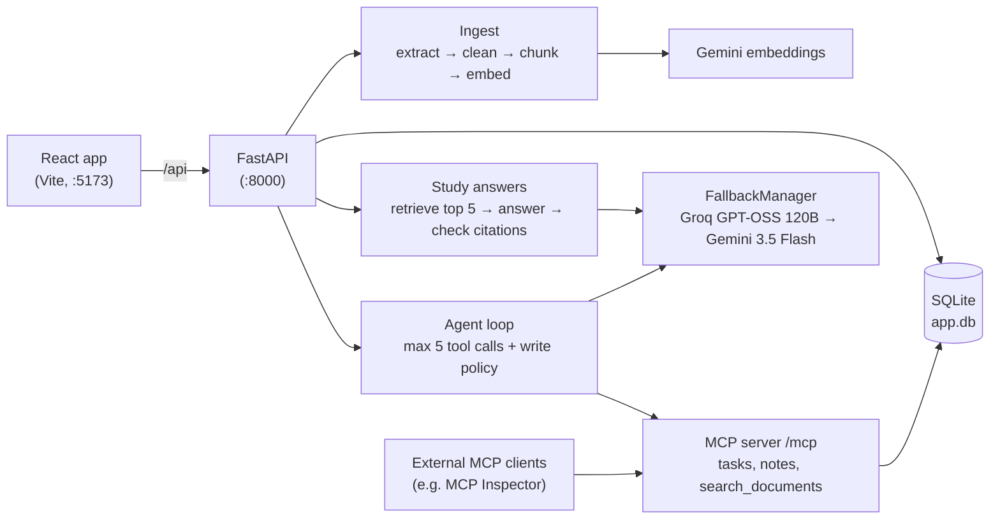

# StudyMate AI

An AI study assistant that runs on your own computer: chat with an AI, upload your PDFs and
ask questions answered **only from them, with page citations**, get summaries, and let the AI
create study tasks and notes for you through **MCP tools**.

> **v1.0, local and single-user.** There is no login yet, so it only accepts requests from
> your own computer. Don't deploy it publicly: auth comes in v1.1. Built in public, one Jira
> ticket at a time ([learning log](docs/learning-log.md)).

*A 2-minute demo video and screenshots are coming soon (SMA-55).*

## What it does

- **Chat** with a free AI model (Groq GPT-OSS 120B by default, Gemini 3.5 Flash as an
  automatic fallback). Answers appear word by word as they're written, with a **Stop**
  button. Markdown and maths, a model selector, and badges showing which model answered.
  Chats are saved and get short AI titles.
- **Documents:** upload PDF, Word (DOCX), TXT or Markdown files (up to 4 MB) and watch them being read,
  split into chunks and embedded. Each one gets an AI **summary and key points**.
- **Study:** pick documents and ask questions. Answers come only from those documents, with
  citations like `[1] Physics.pdf p.12` and a Sources panel; if the answer isn't there, it
  says **"Not found in your documents"** instead of guessing.
- **Tasks and notes, created by the AI:** "Add a task to revise chapter 3 by Friday" calls
  the app's own MCP tools. New items get an **Undo** button; changes to existing ones wait for
  you on a **confirmation card**. Text inside documents or notes can never trigger a write.
- **Quizzes:** multiple-choice questions written from one of your documents (5 or 10), each
  with an explanation and its page; take a quiz, see your score, try again (best scores kept).
- **Flashcards:** decks written from a document (10 cards) or from any chat answer ("Make
  flashcards" under it, up to 5); flip each card and mark whether you knew it.
- **Progress:** quiz average and a chart of recent scores, cards known, tasks done this
  week / open / overdue, and documents studied.
- **Notes** (search, tags, "Save as note" on any answer) and a **Tasks** board
  (To do / Doing / Done).
- An **evaluation harness** that scores answers, citations and retrieval on 30 fixed questions
  ([results](#evaluation-results)).

## How it works



1. The **React** frontend calls the API through Vite's dev proxy (`/api`), so there's no CORS
   setup and no backend address in the frontend code.
2. **FastAPI** keeps everything in **SQLite** (chats, notes, tasks, document chunks and their
   vectors). The schema changes only through Alembic migrations.
3. **Uploads** are checked by their content (not their name), then extracted page by page,
   cleaned, cut into ~800-token chunks with overlap, and embedded with `gemini-embedding-2`.
4. A **study question** is turned into a vector and compared (cosine similarity, NumPy) with
   the chunks of *your chosen documents only*. The top 5 go to the model as tagged reference
   material; every `[n]` citation in the answer is checked against what was retrieved.
5. **Chat with tools:** the backend runs the agent loop. The model asks for a tool, the
   backend runs it through the app's MCP server for the signed-in user, and sends back the
   result. Which user a tool acts for comes only from the server, never from the model.
6. Every AI call goes through the **FallbackManager**: if the main model is rate-limited (429)
   or unavailable (503), the next model that has the needed abilities answers.

Every API endpoint, the MCP tools and the write-action rules are described in
[docs/reference.md](docs/reference.md). The reasons behind the design are in the
[architecture decision records](docs/adr/README.md).

## Run it locally

You need:
- **Python 3.12**: `py -3.12 --version` on Windows, `python3.12 --version` on macOS/Linux
- **Node 22 LTS** with npm: `node --version`
- **Git**
- Two free API keys (no credit card):
  - **Groq**, for chat: [console.groq.com/keys](https://console.groq.com/keys)
  - **Gemini**, for document embeddings and the fallback model:
    [aistudio.google.com/apikey](https://aistudio.google.com/apikey)

Commands are for **Windows Command Prompt**. On macOS/Linux use `python3.12` instead of
`py -3.12`, `source .venv/bin/activate` to activate, and `cp` instead of `copy`.

### 1. Backend (one time)

```bat
git clone https://github.com/devbuildswithsam/studymate-ai.git
cd studymate-ai\backend

:: A virtual environment with Python 3.12, then the packages
py -3.12 -m venv .venv
.venv\Scripts\activate
python -m pip install -r requirements.txt -r requirements-dev.txt

:: Settings: copy the example, then open .env and paste your two API keys
copy .env.example .env
notepad .env

:: Create the database (backend\app.db) and the local user
alembic upgrade head
python -m scripts.seed
```

`backend\.env` holds your keys. It is git-ignored: **never commit it or paste it anywhere.**

| Setting | Default | Meaning |
|---|---|---|
| `GROQ_API_KEY`, `GEMINI_API_KEY` | empty | Your keys. A model without a key shows as `no_key` |
| `ENV` | `development` | `development`, `test` or `production` |
| `AUTH_MODE` | `local` | `local`: single user, no login, requests from this computer only (refused when `ENV=production`). `jwt`: real accounts with a login cookie (v1.1, [ADR-0009](docs/adr/0009-self-built-auth.md); the login pages arrive in SMA-59) |
| `JWT_SECRET` | empty | Signs login sessions; needed for `AUTH_MODE=jwt`, at least 32 characters. Make one: `python -c "import secrets; print(secrets.token_urlsafe(48))"` |
| `FRONTEND_ORIGIN` | `http://localhost:5173` | The only origin allowed by CORS |
| `DATABASE_URL` | `sqlite:///./app.db` | `./` is the folder you start from, so run the API and `alembic` from `backend\` |

### 2. Frontend (one time)

In a new Command Prompt:

```bat
cd studymate-ai\frontend
npm install
```

### 3. Start it (every time)

Use two Command Prompt windows and keep both open.

**Window 1, the API** (from `studymate-ai\backend`):

```bat
.venv\Scripts\activate
uvicorn app.main:app --reload --host 127.0.0.1 --port 8000
```

**Window 2, the app** (from `studymate-ai\frontend`):

```bat
npm run dev
```

Open **<http://localhost:5173>**. The sidebar should say **API online**. Stop either one
with **Ctrl+C**.

### 4. Try it

1. **Chat:** ask "Explain Newton's second law with an example". The badge under the answer
   shows which model replied.
2. **Documents:** upload a PDF (public study material only, see below). Wait for **Ready**,
   then open it to read its summary and key points.
3. **Study:** click **Chat with this document** and ask something it covers: the answer cites
   pages. Ask something it doesn't cover: it says "Not found in your documents".
4. **Tasks via chat:** in Chat, type "Add a task to revise chapter 3 by Friday". You'll see a
   "Used tool: create_task" line and an Undo button; the task appears on the **Tasks** board.

### Accounts (optional, v1.1)

By default the app runs in **local mode**: one user, no login. To try real accounts
(register, log in, log out; [ADR-0009](docs/adr/0009-self-built-auth.md)):

1. Make a secret, from `backend\` with the venv active:
   `python -c "import secrets; print(secrets.token_urlsafe(48))"`
2. In `backend\.env` set `AUTH_MODE=jwt` and `JWT_SECRET=` followed by that secret.
3. Restart the API and open <http://localhost:5173>: you'll see **Log in**. Click **Create one**
   to register; the app opens signed in. The sidebar shows who you are and a **Log out** button.

Sessions last 8 hours. Set `AUTH_MODE=local` to go back.

**Your local-mode data** belongs to the local user, who has no password. To use it with
accounts, give it one (from `backend\` with the venv active), then log in as
`local@studymate.dev`:

```bat
python -m scripts.set_password local@studymate.dev
```

The same command resets a **forgotten password** for any account ("ask the admin"). It asks
for the new password twice and never shows it.

**MCP clients with accounts on:** programs like MCP Inspector need a **personal access token**.
Click the gear icon next to your name (**Settings**), create a token, copy it (it's shown
once), and give it to the program as a Bearer token with the URL `http://127.0.0.1:8000/mcp`.
Revoke it there when you no longer need it.

### If something goes wrong

| You see | Do this |
|---|---|
| "The local user is missing" | From `backend\` with the venv active: `python -m scripts.seed` |
| The API won't start: "The database ... is at ..., but the code needs ..." | New code added a table: from `backend\` with the venv active, run `alembic upgrade head` (do this after every `git pull`) |
| The sidebar says the API is offline | Is window 1 still running? Restart it with the `uvicorn` command |
| A model shows `no_key` | Its key is missing in `backend\.env`; restart the API after editing it |
| "The AI is busy" | A free-tier limit was hit: wait a minute and try again |
| A document is **Failed** at embedding | Usually a rate limit: click **Retry**; it continues where it stopped |
| The API won't start and names a field in `models.yaml` | The model registry has a mistake ([ADR-0001](docs/adr/0001-model-ids-only-in-models-yaml.md)) |
| 403 from another device | Expected: local mode only accepts requests from this computer |
| 403 "didn't come from the StudyMate app" | Open the app at exactly `FRONTEND_ORIGIN` (default <http://localhost:5173>, not `127.0.0.1:5173`): other addresses are blocked as a safety check (SMA-58) |

## Free-tier notes

StudyMate runs on free API tiers, which change often. As of November 2026:

- **Groq** (chat, the default model) is fast (answers in 1–4 s) but limits requests and
  tokens per minute and per day. A 429 makes the app switch to the fallback model for a while.
- **Gemini** is used for **embeddings** (every upload needs it) and as the **fallback** chat
  model. Its free tier was often slow or overloaded during development (timeouts, 503s;
  [ADR-0007](docs/adr/0007-groq-as-default-model.md)). Embeddings are sent in small batches to
  stay under its limits.
- **Gemini's free tier may use your prompts to improve Google's models.** Only upload and
  ask about **public** study material, never anything private.
- Model names and abilities live in one file only,
  [`backend/app/services/llm/models.yaml`](backend/app/services/llm/models.yaml).
  `python -m scripts.check_models` (from `backend\`, uses your keys) checks each enabled model
  for chat, tool calling and JSON output.

## Evaluation results

`backend/evals/` asks 30 fixed questions about three public Wikipedia PDFs and scores the
answers with plain code, so runs can be compared ([how it works](backend/evals/README.md)).
First run, 19 November 2026, fallback off:

| | Target | GPT-OSS 120B (Groq) | Gemini 3.5 Flash |
|---|---|---|---|
| Correct answers (key facts + grounded) | ≥ 80% | 17/22 (77%) | 2/22 |
| Correct citations | ≥ 90% | 17/20 (85%) | 2/2 |
| Invented citations | 0 | 0 | 0 |
| Retrieval hit rate@5 / MRR | ≥ 85% | 18/22 (82%) / 0.65 | same retrieval |
| Correct "not found" refusals | ≥ 90% | 5/5 | 0/5 (failed calls) |
| Tool calls | ≥ 90% | 3/3 | 0/3 (failed calls) |
| Latency p95 | < 10 s | 3.7 s | 56 s |
| **39-page PDF: correct and cited** | ≥ 8/10 | **9/10** | 1/10 |

GPT-OSS's misses were all "not found" answers, never wrong ones; 3 of them were retrieval
misses, the first thing to improve. Gemini's free tier failed 28 of 30 calls that day.
Details and follow-ups: [results notes](backend/evals/results/2026-11-19-notes.md).

## Tests and code quality

Tests never call real AI APIs: they use a fake provider and a fake HTTP server.

```bat
:: Backend, from backend\ with the venv active
pytest
pre-commit run --all-files

:: Frontend, from frontend\
npm test
npm run lint
npm run build
```

- `tests/test_isolation.py` proves another user's chats, notes, tasks, actions and documents
  answer **404**. `tests/test_red_team.py` plants "ignore previous instructions" in notes and
  tool results and checks nothing is written.
- To make the hooks run on every commit, run `pre-commit install` once from the repo root.
  If a hook prints **Failed** (files were modified), the commit did **not** happen: `git add`
  and commit again.
- Commits follow conventional commits with the Jira key, e.g.
  `feat(SMA-49): study chat with grounded answers and checked citations`.

## Tech stack

React 19 + TypeScript, Vite, TanStack Query, Tailwind/shadcn · FastAPI, SQLAlchemy 2, Alembic,
SQLite · MCP Python SDK · pypdf, python-docx, NumPy · Groq and Gemini through their OpenAI-compatible APIs

## Documentation

- [Technical reference](docs/reference.md): API endpoints, MCP server, agent loop, write
  policy, migrations, project structure
- [Architecture decision records](docs/adr/README.md): why things are the way they are
- [Learning log](docs/learning-log.md): what I did and learned, ticket by ticket
- Evaluation documents: Wikipedia articles under CC BY-SA 4.0
  ([attribution](backend/evals/documents/ATTRIBUTION.md))

## Roadmap

- **v1.0** (this release): local MVP with chat, documents with cited answers, summaries,
  notes, and tasks created by the AI through MCP
- **v1.1:** login, streaming answers, quizzes and flashcards, public deployment
- **v1.2:** polish and showcase
